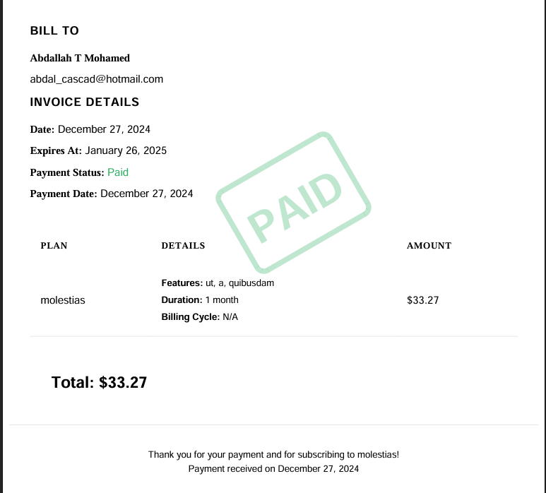

# Documentación de OfflineCashier

OfflineCashier es un paquete de Laravel que proporciona gestión de suscripciones y pagos con soporte para métodos de pago tanto fuera de línea como en línea.

## Características

- Gestión de suscripciones (crear, cancelar, reanudar, cambiar planes)
- Múltiples métodos de pago (efectivo, cheque, transferencia bancaria, Stripe)
- Generación de facturas
- Generación de PDF
- Notificaciones por correo electrónico
- Integración con Stripe
- Vistas personalizables
- Sistema de eventos
- Asignación automática de características: Asigna automáticamente características a las suscripciones según el plan seleccionado.
- Asignación de características personalizable: Proporciona un hook para que los desarrolladores personalicen o anulen la lógica de asignación de características predeterminada.

## Tabla de contenidos

1. [Instalación](docs/installation.md)
2. [Configuración](docs/configuration.md)
3. [Uso básico](docs/basic-usage.md)
4. [Métodos de pago](docs/payment-methods.md)
5. [Eventos y notificaciones](docs/events-notifications.md)
6. [Integración con Stripe](docs/stripe-integration.md)
7. [Generación de facturas](docs/invoice-generation.md)
8. [Pruebas](docs/testing.md)

## Ejemplo de uso

A continuación se muestra un ejemplo de cómo usar el `SubscriptionService` y `InvoiceService` dentro de un componente de Livewire para gestionar suscripciones y pagos:

```php
namespace App\Livewire\Subscription;

use Livewire\Component;
use AMohamed\OfflineCashier\Models\Plan;
use AMohamed\OfflineCashier\Models\Subscription;
use Illuminate\Support\Facades\Auth;
use AMohamed\OfflineCashier\Services\InvoiceService;
use Illuminate\Support\Facades\Log;
use AMohamed\OfflineCashier\Services\SubscriptionService;

class SubscriptionComponent extends Component
{
    public $plans;
    public $selectedPlan;
    public $paymentMethod = 'cash';
    public $referenceNumber;
    protected $invoiceService;
    protected $subscriptionService;

    public function __construct()
    {
        $this->invoiceService = new InvoiceService();
        $this->subscriptionService = new SubscriptionService();
    }

    public function mount()
    {
        $this->plans = Plan::with('features')->get();
    }

    public function selectPlan($planId)
    {
        $this->selectedPlan = Plan::find($planId);
    }

    public function subscribe()
    {
        $this->validate([
            'selectedPlan' => 'required',
            'paymentMethod' => 'required|in:cash,check,bank_transfer,stripe',
            'referenceNumber' => 'required_if:paymentMethod,cash,check,bank_transfer'
        ]);

        $subscription = $this->subscriptionService->create(Auth::user(), $this->selectedPlan, $this->paymentMethod);

        $payment = $subscription->payments()->create([
            'amount' => $this->selectedPlan->price,
            'payment_method' => $this->paymentMethod,
            'status' => 'completed',
            'reference_number' => $this->referenceNumber,
            'paid_at' => now(),
        ]);

        $this->invoiceService->generate($payment);

        session()->flash('message', 'Successfully subscribed to ' . $this->selectedPlan->name);

        $this->reset(['selectedPlan', 'paymentMethod', 'referenceNumber']);
    }

    public function render()
    {
        return view('livewire.subscription.subscription-component');
    }
}
```

## Representación visual



Esta imagen ilustra el proceso de creación de suscripciones y la asignación de características.

## Ejemplo de proyecto

Para ver un ejemplo práctico de cómo usar el paquete OfflineCashier, consulte este [repositorio de GitHub](https://github.com/Abdallah-Tah/cashier). Demuestra la implementación del paquete en un proyecto del mundo real.
